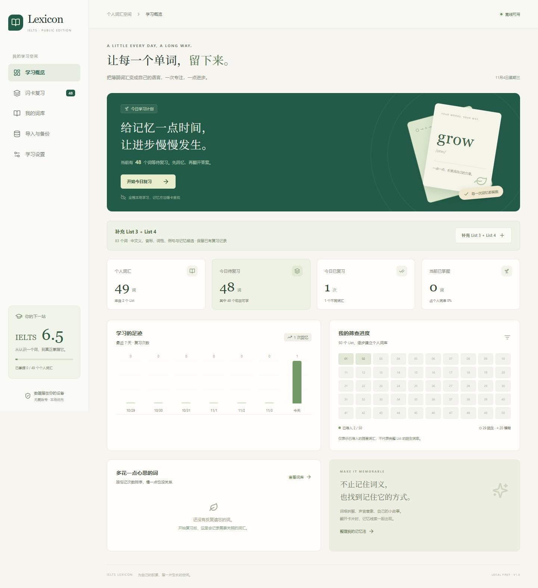

# IELTS Lexicon

**把“看到认识”的英语单词，变成能够稳定回忆和使用的个人词汇。**

[在线使用](https://kada666.github.io/ielts-lexicon/) · **简体中文** · [English](README.en.md) · [技术与数据维护说明](docs/technical-guide.zh-CN.md)

> 统一公开版：程序与 Markdown 词汇资料公开，手写原图不发布。每个人的复习记录、个人修改与设置只保存在自己的浏览器中。



> 截图来自隔离测试词库。系统不上传个人学习记录，也不承诺任何考试提分结果。

## 项目用途

IELTS Lexicon 是一个本地优先、支持离线使用的个人雅思词汇学习系统，面向已经有一定英语阅读基础、仍有陌生词、模糊词和熟词生义需要巩固的学习者。

项目从一套含 50 个 List 的雅思词汇书筛查流程出发：跳过已熟练识别的词，只收集真正薄弱的部分；把手写记录逐步转为可审核、可复习、可备份的个人词库。原始学习场景为 IELTS Academic 6.5 备考，也支持继续追加听力、阅读、写作和口语训练中的词汇。

## 解决什么问题

| 学习中遇到的问题 | IELTS Lexicon 的做法 |
| --- | --- |
| 大部分词已经认识，逐页重背效率低 | 仅收录个人筛出的 ○ 陌生词和 △ 模糊词，保留原始 List 与分组 |
| 看过答案就认识，独立回忆却不稳 | 闪卡先显示英文，翻开后再看中文义和线索，最后自评 |
| 手写词表分散，新增资料难维护 | 保留原图，以 Markdown 主词库和 JSON 逐批积累 |
| 词义容易忘，统一口诀不适合自己 | 词根、构词、拟声、谐音、自由联想和词族线索可由用户选择与编辑 |
| 不知道什么时候复习 | 根据“忘记 / 模糊 / 记住”安排下次复习，记录每次评分 |
| 担心新词覆盖进度或个人口诀 | 词汇、个人修改、复习状态和历史分开存储，同词跨 List 合并 |
| 不想注册账号或购买云服务 | 浏览器本地数据库、PWA 离线缓存、完整备份与迁移 |

## 主要功能

- **主动回忆闪卡**：大字呈现单词、音标、中文义和首选联想；大按钮收起与前后跳转，长按快速编辑联想。例句和搭配保留在词条编辑中。
- **六类记忆线索**：真实词源、构词拆解、拟声、谐音、自由联想、词族。词源与趣味联想明确区分，候选内容独立标记待审核。
- **词库速览**：桌面左词右义，悬停释义显义，可调字号。按 List、初始分类和学习状态筛选，点击单词编辑。
- **基础间隔复习**：陌生词起始间隔更短，连续记住延长间隔，遗忘后缩短；V1 使用简单可测试规则，尚未采用 FSRS。
- **学习概览**：词汇量、已导入 List、掌握情况、今日复习、7 天趋势与困难词。
- **数据迁移**：完整 JSON 备份恢复、JSON 增量导入、CSV 词库导出，保留已有学习历史与个人修改。
- **离线学习**：缓存完成后，断网仍可重载、翻卡、评分和保存。

## 开始使用

在线地址为 **[IELTS Lexicon](https://kada666.github.io/ielts-lexicon/)**。统一公开仓库和看板链接；桌面入口可直接打开在线版，也可运行本地副本。

1. 点击“核对并导入初始词库”，预览 List 1～4 共 **139 个候选词**。已有词库时，点首页“更新词库与笔记”增量合并。只补 List 3、4 时，可在“导入与备份”选择对应范围。
2. 查看 Markdown 文字笔记，核对拼写及 ○ / △ 后导入；可逐 List 核对更多候选。
3. 开始复习：先回忆 → 翻开 → 查看词义与记忆线索 → 评分。
4. 在词库中补充自己的记忆方法，并定期导出**完整 JSON 备份**。

**已有本地版数据时：**先在原 localhost 页面导出完整备份，再到在线版恢复。不同网址、浏览器和设备拥有各自存储空间，不会自动同步。

### 安装与离线

电脑可通过支持的浏览器安装入口使用；iPad / iPhone 可在 Safari 分享菜单选择“添加到主屏幕”。首次访问需要联网，等右上出现“离线可用”后再断网。HTTPS 或本机 localhost 才能支持本项目的离线缓存，普通局域网 HTTP 不适合作为 iPad 安装地址。

清理站点数据或系统回收存储可能删除记录，安装不替代备份。[详细运行条件](docs/technical-guide.zh-CN.md)。

### 本地运行

需要 Node.js 22.12+。克隆后执行：

```sh
npm ci
npm run build
npm run preview -- --port 4173 --strictPort
```

打开 `http://127.0.0.1:4173/`。Windows 可双击 `start-lexicon.cmd`。开发使用 `npm run dev`，离线验证使用生产构建。

## 数据来源与持续扩充

初始材料为用户提供的 List 1～4 手写筛查表，已转写为 [List 1](data/notes/list_01.md)、[List 2](data/notes/list_02.md)、[List 3](data/notes/list_03.md)、[List 4](data/notes/list_04.md) 四份 Markdown；公开仓库不含原始手写图片。未提供完整 List 总词数，因此不把个人导入占比称为“整本陌生词率”。

| List | ○ 陌生 | △ 模糊 | 练习 | 候选数 |
| --- | ---: | ---: | ---: | ---: |
| 1 | 14 | 10 | 0 | 24 |
| 2 | 15 | 10 | 0 | 25 |
| 3 | 28 | 15 | 0 | 43 |
| 4 | 22 | 19 | 6 | 47 |
| 合计 | 79 | 54 | 6 | 139 |

四份详解笔记整理为 **91 条手写记忆法**，按词块、口诀、记忆链和关联词展示。后续可直接修改 [各 List 的 Markdown](data/notes/)。List 3、4 另提供 [90 词导入文件](data/vocabulary.list_03_04.json)。[词表核对记录](data/import_review.md)

未确认转录保存在 `vocabulary.pending.json`，在看板预览确认后写入本地词库。释义、音标、例句和记忆候选保留各自的审核状态。「练」在词库中单独显示，调度沿用模糊词的间隔。

```text
手写笔记文字版 → Markdown 主词库 → 人工审核
                         ↓ npm run build:data
                    JSON → 应用确认导入 → IndexedDB
```

可继续追加至 List 50，也可导入四科训练中的其他来源，无需虚构 List。参见[审核清单](data/import_review.md)、[主词库](data/vocabulary_master.md)、[外部来源示例](data/external-source.example.json)。

## 数据保存与隐私

学习数据库保存在当前设备的 **IndexedDB**。无需账号、付费云数据库或运行时 AI / OCR API。GitHub Pages 提供静态程序及内置候选资料，个人复习历史和修改留在浏览器。

完整 JSON 包含词库、个人修改、复习状态、全部历史和设置；CSV 只用于查阅。恢复会替换当前设备数据，应用会要求确认并先下载当前备份。V1 不自动合并不同设备上独立产生的历史。

## 技术与验证

React · TypeScript · Vite · IndexedDB / idb · Service Worker · PWA。

```sh
npm test             # 数据、去重、调度、备份与迁移
npm run build        # Markdown 转换、类型检查与生产打包
npm run test:e2e     # 隔离 Chrome：导入、编辑、评分、恢复与断网
```

V1 已通过 **17 项单元测试、11 项浏览器测试**，检查桌面、834px iPad 尺寸、390px 手机布局和触屏操作。iPad Safari / macOS 实机安装尚未验证。[验收记录](docs/verification.md)。

推送 `main` 后，GitHub Actions 自动测试、构建并发布唯一的 Pages 看板。后续规划包括 FSRS、听音辨词、词义默写、词族联动和四科来源分析；V1 不提供跨设备自动同步。

## 统一发布与使用边界

只有一个维护中的公开仓库和一个看板链接。仓库更新共享程序与基础词库，不会把浏览器中的学习记录上传到 GitHub；更新基础词库需要在应用中确认合并。不同人、不同浏览器、不同设备的 IndexedDB 独立。共用同一浏览器配置文件会共用该站点的数据，请用不同浏览器配置文件区分使用者。

公开版从干净历史创建，排除原始手写图及旧 Git 历史。原私有仓库仅作封存历史，不再作为日常维护或部署入口。

## 手机阅读与单词发音

手机词库采用左词右义的连续滚动列表，○ / △和来源轻量显示，不显示学习状态与复习时间。闪卡主要文字放大，前后切换不计评分，本轮已评分卡可回看且不会重复评分。

点击音标或喇叭听英式英语（设备语音合成，优先本地en-GB）。离线朗读需要设备已安装English (UK)语音；缺少时提示，不影响离线背词和评分。详见[手机交互与发音说明](docs/mobile-reading.md)。
